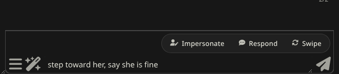
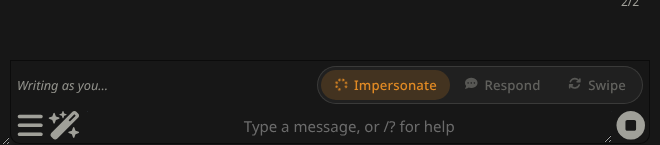
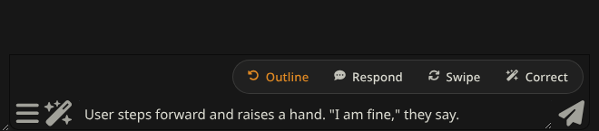
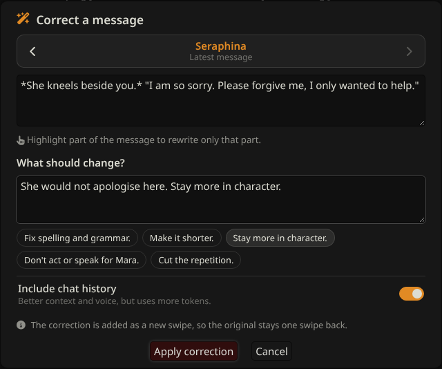
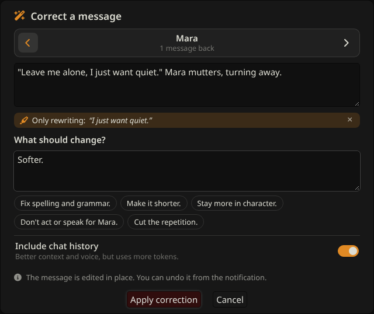
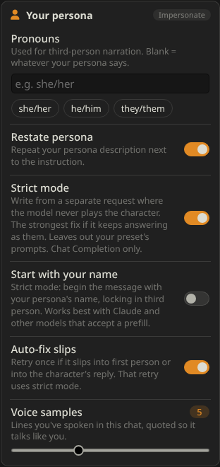

# Guided Gens SI

A small, focused SillyTavern extension based on the idea behind
[Guided Generations](https://github.com/Samueras/GuidedGenerations-Extension) by Samueras.
It has just four buttons, and they're built to stay in character.

| Button | What it does |
| --- | --- |
| **Impersonate** | Turns the outline in your input box into **your persona's** next message, always in **third person**. Afterwards the button becomes **Outline**: click it to get your outline back. |
| **Respond** | The character replies following the direction in your input box, **in their own voice**. |
| **Swipe** | A new swipe of the character's last message, following your direction, **in their own voice**. Leave the box empty for a plain swipe. |
| **Correct** | Rewrite any message, or just a highlighted part of it, from your instructions, keeping the speaker's voice. See [Corrections](#corrections). |

While one runs, it shows a spinner and a short status, and the other buttons are locked so you can't start two generations at once.

**Stopping:** a red **Stop** button appears while something runs. You can also click the spinning button again, press **Esc**, or use SillyTavern's own stop button. The request is cancelled and nothing is applied: no auto-retry, no correction, and Impersonate puts your outline back in the box. On narrow screens (or with **Compact** on) the bar shows icons only.

## How it differs from the original

**Impersonate sounds like you, and only in third person**
- The prompt gives the model your persona description plus a few lines you've actually spoken in this chat, so it copies how *you* talk instead of a generic voice.
- It has strict rules: third-person narration only, only your persona's own words and actions, and nothing written for the character.
- Your direction is the last and most emphasised part of the prompt, so it wins over the story's momentum. Write it however you like, even in first person (`I grab her wrist and say "Stop fussing." then I walk out`): it's turned into third person, every beat is kept in order, and lines in quotes are kept as written.
- The result is checked. If the narration slips into "I/me/my", **or the result reads like the character's reply instead of yours**, it retries once automatically (you can turn this off). It also removes a leading `YourName:` and cuts off anything after the model starts a `CharName:` line.
- Set your pronouns in the settings (e.g. `she/her`) so the model never has to guess.

**Stopping it from answering as the character (Strict mode)**

With Chat Completion APIs (Claude, GPT, Gemini, OpenRouter, …) the model spends the whole chat playing the character, and your preset usually says "write {{char}}'s next reply". SillyTavern's impersonation only adds a note at the end, so models often slide back into the character's reply.

**Strict mode** sends impersonation as a separate request where the model never plays the character:
- The system prompt says it writes only for your persona and is *not* the character.
- The character card, scenario and active world info are included as reference only.
- The story so far is a transcript, followed by your outline and the third-person rules.

**Start with your name** goes one step further and makes the model begin with your persona's name, which locks in third person. That works best with Claude and other models that accept a prefill.

Even with Strict mode off, **Auto-fix slips** notices when a result reads like the character's reply and retries that one in strict mode. It looks for narration that calls you "you", openings with the character's name, and narration that's mostly about the character.

Strict mode leaves out your preset's prompts (main prompt, jailbreak and so on). If your model needs those to write freely, keep Strict mode off and rely on Auto-fix. With Text Completion APIs, SillyTavern's impersonation already ends the prompt with `YourName:`, which keeps the model on your side, so Strict mode isn't needed (or used) there.

**Response and swipe sound like the character**
- The original sent your text as a bare instruction (`[Take the following into special consideration…]`) right after the last message, so models often answered the note, or switched into an assistant voice.
- This version sends it as a private author's note that keeps the character's personality, speech patterns, formatting and length, and ends with your direction marked as the top priority: all of it must happen in this reply, in order, with quoted lines kept exactly. Shorthand works ("she pours me tea and says \"Drink. Now.\"": "I/me" is you, "she/he" is the character).
- **Placement matters.** In Chat Completion, a note inside the chat history comes *before* your preset's post-history instructions ("write {{char}}'s next reply…"), which then override it. So by default the direction is sent as the very last message, after everything else, the same spot SillyTavern gives impersonation. (Text Completion has no post-history block, so it goes in at depth 0.)
- It includes a few of the character's own recent lines as a voice anchor. For swipes, the message being replaced is left out.
- The note goes in through SillyTavern's extension-prompt API rather than `/inject` slash commands, so `|` or other special characters in your text can't break it. It's always removed afterwards, even if generation fails or you press stop.

## Direction check

Models (and presets with their own narrator or "next beat" plans) sometimes take your direction as one ingredient and then do their own thing: "Slater is also on stream" comes back as "his stream was offline". So after **Impersonate**, **Respond** and **Swipe**, a small extra request checks the result against your direction. Only your direction and the result are sent, not the chat.

- **Every point carried out:** nothing else happens.
- **Something missed or contradicted:** it's redone once, and the redo is told exactly what was wrong (for example "Slater is offline instead of live on stream"). For Respond and Swipe the redo is a new swipe, so the first try is one swipe back. A notification tells you it happened.
- **Still missed after the redo:** you get a warning listing what's still missing.

The direction note also says that everything in your direction is true in the story now (even if it contradicts what came before), and that it overrides any plans of the model or the preset's narrator for the plot or next beat.

Turn the check off under **Directions** in the settings if you'd rather save the extra request.

## Corrections

Click **Correct** to open the corrections window.

1. **Pick the message.** It opens on the latest message; use the arrows to go to older ones (yours or the character's). For the character's latest reply you can also pick which swipe to start from.
2. **Optionally highlight part of it.** Only that part is rewritten, and the rest of the message stays exactly as it was. A bar shows what's selected; **×** goes back to the whole message.
3. **Say what should change**, or tap a quick fix (fix grammar, shorter, more in character, don't act for you, less repetition). Ctrl/⌘+Enter applies.
4. **Include chat history** (on by default) gives the model the whole story and character card. Turn it off for a cheaper call; the speaker's description is still included so the voice holds.

Where the result goes:
- **The character's latest reply:** added as a **new swipe**, so the original is one swipe back.
- **Any other message (including yours):** edited in place, and the notification has an **undo**: click it within a few seconds to put the original back.

The rewrite prompt asks the model to change only what you asked for and to keep the speaker's voice, point of view and tense. Stray code fences, `"""` marks, name prefixes and added quotes are cleaned off before it's applied.

## Installation

1. In SillyTavern open **Extensions → Install extension**.
2. Paste `https://github.com/howardsierra/guidedgens-si` and install.
3. The three buttons appear above the chat input. Settings are under **Extensions → Guided Gens SI**.

Requires a recent SillyTavern (1.13.0+ for Guided Swipe). It can run alongside the original Guided Generations extension.

## Settings

Under **Extensions → Guided Gens SI**. Everything follows your SillyTavern theme colours.

 

- **Buttons**: show or hide each button; **Compact** for icons only.
- **Directions**: **Check the direction was followed** (on by default). See [Direction check](#direction-check).
- **Your persona**
  - **Pronouns**: type them or tap a chip (she/her, he/him, they/them). They're used in the third-person rule.
  - **Restate persona**: repeats your persona description right next to the instruction (turn it off to save tokens).
  - **Strict mode**: impersonate from a separate request where the model never plays the character (see above). Chat Completion only.
  - **Start with your name**: in strict mode, begin the message with your persona's name.
  - **Auto-fix slips**: one automatic retry if the narration uses I/me/my or reads like the character's reply; that retry uses strict mode.
  - **Voice samples**: how many of your spoken lines to quote (0 = off).
- **Character**
  - **Voice samples**: how many of the character's recent lines to quote (0 = off).
  - **Direction at the very end** (on by default): the direction is the last thing the model reads, after your preset's post-history instructions. Chat Completion only.
  - **Direction depth**: where the note goes in the chat when it isn't at the very end (0 = after the last message).
  - **Direction role**: System, User or Assistant. At the very end, Assistant is sent as System, since a trailing assistant message would act as a prefill.
- **Prompts (Advanced)**: edit the impersonate, direction and both correction prompts; **Reset** restores the defaults.

## Tips

- In Chat Completion presets, SillyTavern's own *Impersonation prompt* (under Utility Prompts) is also sent. If it conflicts with your style (for example "internet RP style"), edit it or clear it.
- Groups: Guided Response lets SillyTavern pick who replies, so it skips the voice samples. Guided Swipe uses the voice of whoever wrote the last message.

## Development

`npm test` runs the unit tests for the text helpers (`src/text.js`).

## License

GPL-3.0, the same as the original Guided Generations extension.
